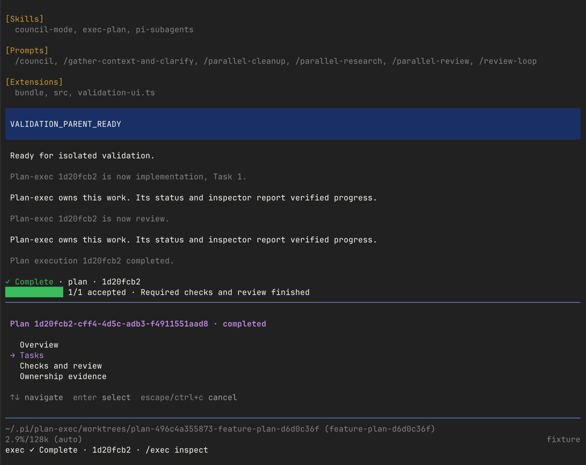

# Pi 1.5 UI validation

Validation used Pi/TUI 1.5.0, pi-subagents 0.84.0 and Node 24.15.0 in
agterm on macOS. The local provider was scripted, with isolated HOME, Git
repositories, native registry and session files. This checks integration and UI
behavior, not model quality or live-provider reliability.

## Process-recovery gate

The v2 direct-single fixture kills the actual host with SIGKILL, confirms the
same child/session survives, then recovers through a fresh controller. It
observed one side effect and zero replacement spawns. Native closure proof
remained pending after host death, so the controller retained ownership rather
than accepting output or treating a dead PID as retirement evidence.

## Observed

| Scenario | Evidence |
| --- | --- |
| Plan handoff | A persisted parent conversation survived handoff to a new worktree. Required review and checks completed on the same verified commit. |
| Goal and review/fix | Both completed with matching reviewed and checked commits. The findings scenario required a fix and a second review. |
| Pause and resume | A held native worker stopped; its matching runner closure was observed. Exact-ID inspector resume completed the original run. |
| Cancel and Escape | Escape dismissed a cancellation dialog without changing the saved run. Confirming cancellation set the selected run to cancelled. |
| Inspector | Arrow keys changed the selected section; actions displayed the full run ID. The dialog did not replace the editor or footer. |
| Visibility | Hide survived reload and retained the selected run. Unhide restored the pinned run without changing its registry record. |
| Narrow display | At 56 and 40 columns, Snapshot, state, short ID, accepted count and inspect action remained visible. A long action was truncated at 40 columns. |
| Themes | Terminal readback and native theme values were checked in light and dark. Pixel capture was unavailable for these cases because the macOS GUI session locked. |

Native completion notifications caused parent model turns; the fixture replies
were scripted. A stopped-child notification produced errors in the original
fixture provider because it accepted only completed notifications; the provider
fixture was updated to recognize stopped/failed notifications. The controller
still recorded pause and matching retirement. The test does not establish that
real parent-model responses are harmless.

The inspector capture below is from the real TUI, cropped to exclude the agterm
sidebar. It predates the final reviewer-model label and observation-metadata
fix; it is not evidence for those later changes.

A display-only foreign-lease fixture used a Unicode filename; it was not an
active controller. Native RGB values for Snapshot/Complete/Paused were
`#cd9a22/#68b78d/#9da5a9` (dark) and
`#8f6802/#337e58/#677176` (light). These are theme values, not a measured
pixel-contrast audit.
